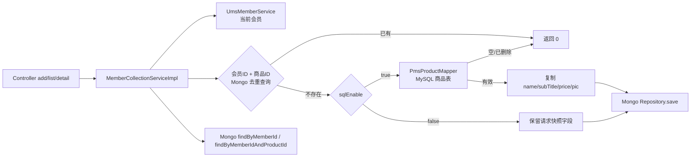

# E1-03 商品收藏：导读参考答案

基线：`7832a9f7dcd5ff16b5b3c6c2b0f178a6b8f2dfe8`（mall，`sdc-java-migration`）。本材料只做代码导读和 Mockito 服务层核验，不连接 Mongo/MySQL，不宣称完成数据库或 HTTP 端到端验证。

## 业务入口

`MemberProductCollectionController` 的公开入口在 `mall-portal/src/main/java/com/macro/mall/portal/controller/MemberProductCollectionController.java`：

- `POST /member/productCollection/add` 调 `MemberCollectionService.add`，返回 `count > 0` 成功，否则失败（28–35 行）。
- `GET /member/productCollection/list` 调 `list(pageNum,pageSize)`，默认第 1 页、每页 5 条（49–56 行）。
- `GET /member/productCollection/detail?productId=` 调 `detail`（58–64 行）。
- 同一控制器还提供 delete/clear，本题重点只展开 add/list/detail。

## add 数据流

依据 `MemberCollectionServiceImpl.java:33–58`：

1. `productId == null` 立即返回 0，不读取当前会员，也不触发任何仓储调用。
2. `UmsMemberService.getCurrentMember()` 提供当前会员；服务把 `memberId`、`memberNickname`、`memberIcon` 写回请求对象。因此请求中的会员字段不是可信身份来源。
3. 以当前会员 ID 与商品 ID 调 Mongo Repository 的 `findByMemberIdAndProductId` 去重。已有收藏返回 0，不查 MySQL，也不 save。
4. `sqlEnable=true` 时调用 `PmsProductMapper.selectByPrimaryKey(productId)`。商品为空或 `deleteStatus == 1` 返回 0；否则把商品表的 `name`、`subTitle`、`price + ""`、`pic` 复制到收藏对象，再 `save` Mongo。
5. `sqlEnable=false` 时跳过 MySQL，直接保存请求对象中已有的商品快照字段。该分支的前提是调用方已经提供所需字段，服务没有再补齐或校验。

收藏文档 `MemberProductCollection.java:18–31` 保存会员字段、商品 ID、商品名称/图片/副标题/价格和创建时间；`memberId` 与 `productId` 有 Mongo `@Indexed`，Repository 的组合条件见 `MemberProductCollectionRepository.java`。

## list/detail 查询条件

- `list`（服务 67–70 行）从当前会员取得 ID，构造 `PageRequest.of(pageNum - 1, pageSize)`，调用 `findByMemberId(memberId, pageable)`。
- `detail`（74–76 行）从当前会员取得 ID，调用 `findByMemberIdAndProductId(memberId, productId)`。
- 因而两者都不能由请求参数指定任意会员。测试只验证传给 Repository 的条件与分页对象，不证明 Mongo 实际索引、排序或分页结果。

## 关键判断

| 判断 | 源码依据 | 本轮证据边界 |
|---|---|---|
| 收藏按当前会员+商品去重 | 服务 38–43 行；Repository 方法签名 | Mockito 验证调用参数；未验证并发竞态或真实唯一索引 |
| `sqlEnable` 决定是否补齐 MySQL 商品快照 | 服务 44–53 行；`application.yml` 与 `application-prod.yml` 均为 true | 两分支单元测试；未启动 Spring 配置绑定 |
| MySQL 商品为空/已删除时不写收藏 | 服务 45–48 行 | mock 返回值测试；未验证数据库删除状态读取 |
| 快照来源在 true 分支是商品表，在 false 分支是请求体 | 服务 49–52 行与 44 行条件 | 捕获保存对象；未验证调用方是否始终提交完整快照 |
| 查询限定当前会员 | 服务 67–76 行 | mock Repository 参数；未验证 Mongo 端实际执行计划 |

## Mockito 验证

`SDC/E1/src/test/java/com/macro/mall/sdc/e1/MemberCollectionServiceTest.java` 直接实例化真实 `MemberCollectionServiceImpl`，仅替换三个协作者：`PmsProductMapper`、`MemberProductCollectionRepository`、`UmsMemberService`。覆盖：

- true：MySQL 商品快照覆盖请求快照并保存；
- false：跳过 MySQL，保留请求快照并保存；
- 重复收藏：返回 0，跳过查商品与 save；
- 商品不存在或已删除：返回 0，不 save；
- list/detail：传入当前会员 ID 及预期分页；
- 缺少 productId：早退且不与任何协作者交互。

这些测试证明真实服务的分支和输入输出协议，以及服务向协作者传递的查询条件；它们不能证明 Mongo/MySQL、事务、索引、并发唯一性或完整认证链。

## 图示



## 运行记录

命令：

```text
JAVA_HOME=/opt/homebrew/opt/openjdk/libexec/openjdk.jdk/Contents/Home \
PATH=/opt/homebrew/opt/openjdk/libexec/openjdk.jdk/Contents/Home/bin:$PATH \
mvn -o -pl SDC/E1 -am test -Dtest=MemberCollectionServiceTest,MallFactsTest \
  -Dsurefire.failIfNoSpecifiedTests=false
```

结果：本轮另以 JDK 17 fresh 执行 `mvn -o -pl SDC/E1 -am clean test -Dtest=MemberCollectionServiceTest,MallFactsTest -Dsurefire.failIfNoSpecifiedTests=false`，BUILD SUCCESS：9 项（`MallFactsTest` 3、收藏服务测试 6），0 failure/error/skipped。JDK 26 尝试未能编译基线 `mall-common`，`WebLogAspect` 找不到 Lombok 生成的 `WebLog` getter/setter（16 个找不到符号错误）；该环境差异未通过改产品代码处理。

未安装/启动 Mongo 或连接 MySQL，也未新增依赖。

