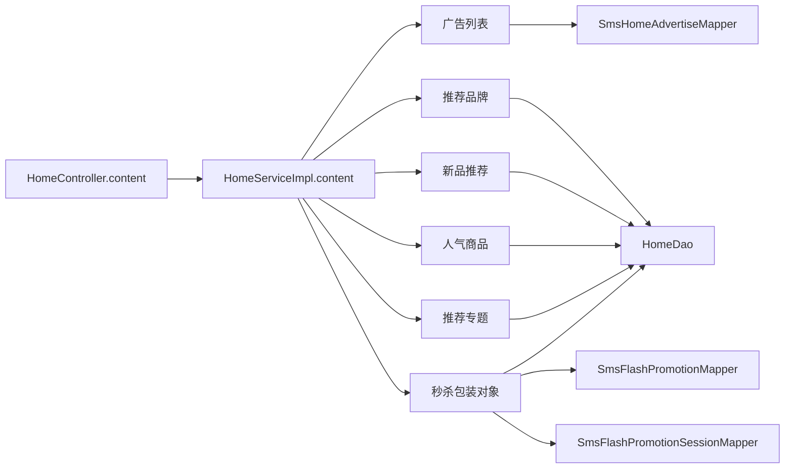

# E1-06 首页内容聚合观察答案

## 结论

`HomeServiceImpl.content()` 在一次服务调用中组装六块内容：广告、推荐品牌、当前秒杀、新品、人气商品和推荐专题。广告来自 `SmsHomeAdvertiseMapper`；品牌、新品、人气、专题来自 `HomeDao`；秒杀先查 `SmsFlashPromotionMapper`，有当前活动后再查场次 Mapper、下一场和 `HomeDao.getFlashProductList`。

首页聚合入口固定传入品牌 `(offset=0, limit=6)`，新品、人气、专题均为 `(0,4)`。这不是分页接口；单独的新品／人气方法才按 `pageNum/pageSize` 计算 offset。广告按类型、状态筛选并按 `sort desc`，具体 SQL 见 `HomeServiceImpl.java:141-145`。HomeDao 的四个列表查询使用 SQL `LIMIT`，并分别限制可推荐、已上架或已展示记录。



无当前秒杀活动时，`getHomeFlashPromotion()` 仍返回一个新建的 `HomeFlashPromotion`；其开始／结束时间、下一场时间和商品列表均为 `null`，首页其它五块仍正常聚合。旧执行计划中的 `assertNull(result.getHomeFlashPromotion())` 与基线实现不符，本次测试按实际代码核实并纠正。

## 受控观察

测试文件：`mall-portal/src/test/java/com/macro/mall/portal/sdc/SDCE106Test.java`。

- `contentAggregatesSixSectionsFromTheirDependencies`：为广告 Mapper、HomeDao、当前活动和秒杀场次提供人工数据，调用真实 `HomeServiceImpl.content()`，断言六块内容、下一场信息和固定参数。
- `missingCampaignLeavesAnEmptyFlashPromotionWrapperWithoutBreakingHomeContent`：单独验证无活动边界，包装对象非空、内部字段为空，且没有继续查询场次或商品。

这是 Mock 替换外部数据依赖后的服务层观察测试。它验证真实服务方法的聚合参数和对象结构，不是数据库、MyBatis SQL、HTTP 或端到端集成测试。首次 JDK 17 执行因仓库默认 Mockito inline maker 无法自附加失败；复用项目现有 `mock-maker-subclass` 配置后定向测试通过。

## 代码依据

- 入口与六次赋值：`mall-portal/src/main/java/com/macro/mall/portal/service/impl/HomeServiceImpl.java:40-55`
- 秒杀边界：同文件 `103-125`、`148-160`
- HomeDao 方法签名：`mall-portal/src/main/java/com/macro/mall/portal/dao/HomeDao.java:20-39`
- SQL 条件与 LIMIT：`mall-portal/src/main/resources/dao/HomeDao.xml:11-75`
- HTTP 入口：`mall-portal/src/main/java/com/macro/mall/portal/controller/HomeController.java:28-34`

## 运行

- checkout：`/private/tmp/mall-e1-06`
- base：`7832a9f7dcd5ff16b5b3c6c2b0f178a6b8f2dfe8`

```sh
rtk env JAVA_HOME=/opt/homebrew/opt/openjdk@17/libexec/openjdk.jdk/Contents/Home \
  PATH=/opt/homebrew/opt/openjdk@17/libexec/openjdk.jdk/Contents/Home/bin:$PATH \
  mvn -pl mall-portal -am -DskipTests=false -Dtest=SDCE106Test \
  -Dsurefire.failIfNoSpecifiedTests=false -Ddocker.skip=true test
```

结果：`Tests run: 2, Failures: 0, Errors: 0, Skipped: 0`，`BUILD SUCCESS`。

## 未验证范围

未连接 MySQL、Redis、消息队列或启动 Spring Boot；未验证真实 SQL 结果、数据库排序／分页、HTTP 序列化、并发、缓存和生产配置。人工列表也不代表线上数据量或数据质量。

原始测试日志：[fresh-targeted-test.log](https://github.com/meng004/mall/blob/exp/e1-06/SDC/E1/outputs/E1-06/evidence/fresh-targeted-test.log)。独立参考分支`exp/e1-06`；Mockito subclass配置限于本教学分支的定向测试，未验证portal全部测试。
